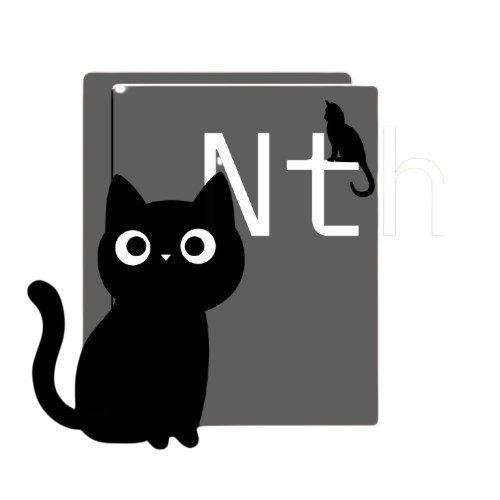

<p align="center">
  
</p>

<h1 align="center">Notohiis</h1>

<p align="center">
  Simples por padrão. Poderoso quando você precisa.
</p>

<p align="center">
  <sub>Python · rust · Textual + CustomTkinter · v0.6-alpha</sub>
</p>

<p align="center">
  <a href="#instalação">Instalação</a> ·
  <a href="#plugins">Plugins</a> 
</p>

<br>

Notohiis é um editor de texto minimalista para quem valoriza foco e controle total sobre a própria ferramenta.

<br>

## Filosofia

o código  é o mais importante , então foque no código então.

- **Minimalismo intencional** — interface limpa, sem ruído visual.
- **Extensibilidade** — o que faltar, você cria com plugins em Python.
- **Modifique para suas necessidades** - sintase livre para adaptá-lo
Você decide o quanto de poder quer expor.

<br>

## Recursos

- Temas completos via JSON
- Sistema de plugins com carregamento dinâmico
- GUI (CustomTkinter) e TUI (Textual), mesma lógica de base
- Git nativo, syntax highlighting, múltiplas linguagens
- Leve mesmo com vários plugins carregados

<br>

## Capturas de tela

<p align="center">
  
  <br><sub>Interface principal</sub>
</p>

<p align="center">

  <br><sub>Modo terminal (TUI)</sub>
</p>

<p align="center">
  
  <br><sub>Plugins</sub>
</p>

<br>

## Instalação

instale o flatipak em laçamentos.
---

```bash
git clone https://github.com/John-BrenoF/notohiis.git
cd notohiis
chmod +x notohiis.sh
./notohiis.sh
```


<br>

## Plugins

Coloque um arquivo Python em `plugins/` e ele é carregado automaticamente. Nada de configuração extra.

estou trabalhando na documentação explicando como cria um pluguins.


<br>

<p align="center">
  <sub> as batatas azuis são lindas /sub><br>
</p>
